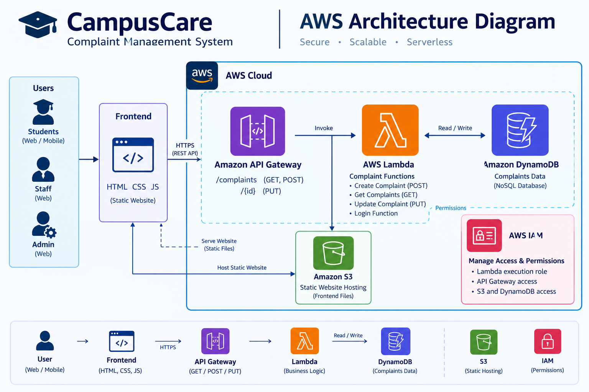

# CampusCare – AWS-Based Complaint Management System

## 📌 Project Overview
CampusCare is a web-based complaint management system developed using AWS services. It allows users to submit complaints and enables administrators to manage complaint records through a centralized dashboard.

## 🎯 Objectives
- Simplify the complaint submission process.
- Store complaint information centrally.
- Enable administrators to manage complaints.
- Demonstrate the integration of AWS cloud services with a web application.

## ✨ Features
- Complaint submission
- Complaint data storage
- Backend processing using AWS Lambda
- REST API integration using Amazon API Gateway
- Administrative dashboard for complaint management

## 🛠️ Technologies Used
- **Frontend:** HTML, CSS, JavaScript
- **Backend:** Python and AWS Lambda
- **Database:** Amazon DynamoDB
- **API:** Amazon API Gateway
- **Hosting:** Amazon S3
- **Access Management:** AWS IAM

## 🏗️ Architecture
The frontend communicates with the backend through Amazon API Gateway. AWS Lambda processes incoming requests and interacts with Amazon DynamoDB to store and retrieve complaint information. Amazon S3 hosts the frontend, while AWS IAM manages permissions for AWS resources.

## 🧪 Testing
The backend functionality was tested using AWS Lambda test events and API requests.

## 🎓 Project Information
**Project Name:** CampusCare  
**Project Type:** College Project  
**Domain:** Cloud Computing and Web Development

## 🚀 Future Enhancements
- User authentication and authorization
- Complaint status notifications
- Complaint tracking for users
- Enhanced administrative reporting

## 🏗️ AWS Architecture

